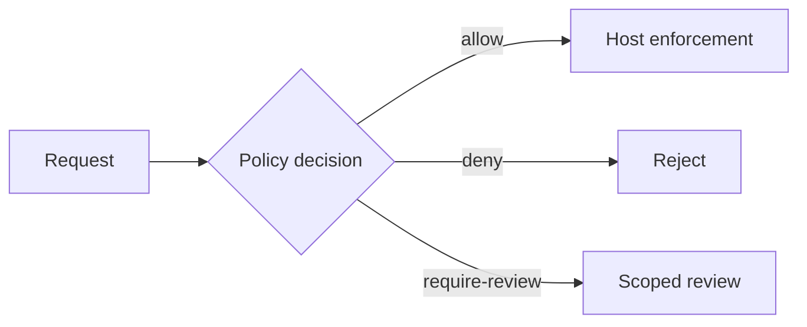

# guardOps

**Trust is a policy, not a prompt.**

Local-first deterministic authorization and governance for AI agent tool requests.

  [](https://github.com/ops-universe/guardOps/actions/workflows/ci.yml)

> Development source repository. Public release is deferred. See [implementation status](docs/status/IMPLEMENTATION-STATUS.md) for scoped evidence and limitations.

## Why guardOps?

A model's request is not permission to act. Keep role and risk context, authorization decisions and side effects under host control.

## Features

- Deterministic policy evaluation and structured argument validation.
- Allow, deny and require-review decisions with simulated approval lifecycle.
- Heuristic guardrail signals, simulation CLI and synthetic dashboard.
- Enterprise gateway and authenticated local audit persistence within the trusted-local scope.

## Architecture



[Architecture](docs/architecture/overview.md) · [Trusted risk ADR](docs/architecture/adr/001-trusted-risk.md)

## Quickstart

Requires Node.js 22+ and npm. Work from the repository root; the package is private and not presented as an npm release.

```sh
git clone https://github.com/ops-universe/guardOps.git
cd guardOps
npm ci
npm test
npm run demo
```

## CLI and examples

Use synthetic fixtures only.

```sh
node src/cli.mjs examples/policy.json examples/request.json
node src/demo.mjs
```

## Configuration

Use the committed [policy](examples/policy.json) and [request](examples/request.json) fixtures. The host supplies authenticated roles independently of model output and controls policy and handlers. CLI exit codes: 0 allow, 2 deny, 3 require-review, 1 invalid invocation or input.

## Scope and limitations

CLI input is simulation only and cannot authenticate users or authorize live execution. Trusted directory, key, host context and handlers required. No distributed or rollback-proof storage, exactly-once effects, security certification or production readiness.

Read the [threat model](docs/security/threat-model.md) before integrating with real data or systems.

## Roadmap

See [ROADMAP.md](ROADMAP.md) and [implementation status](docs/status/IMPLEMENTATION-STATUS.md). Developer Preview launch and public release remain deferred.

## Contributing and support

Read [CONTRIBUTING.md](CONTRIBUTING.md), [Code of Conduct](CODE_OF_CONDUCT.md), and [SECURITY.md](SECURITY.md). Open a focused [issue](https://github.com/ops-universe/guardOps/issues) with a minimal synthetic reproduction or documentation proposal. Run `npm ci` and `npm test` before opening a focused PR. Report security concerns using the security policy rather than public issues.

## Related projects

[evalOps](https://github.com/ops-universe/evalOps) · [ragOps](https://github.com/ops-universe/ragOps) · [traceOps](https://github.com/ops-universe/traceOps) · [mcpOps](https://github.com/ops-universe/mcpOps) · [workflowOps](https://github.com/ops-universe/workflowOps) · [dataOps](https://github.com/ops-universe/dataOps) · [Ops Universe](https://github.com/ops-universe)

## License

[MIT](LICENSE)
